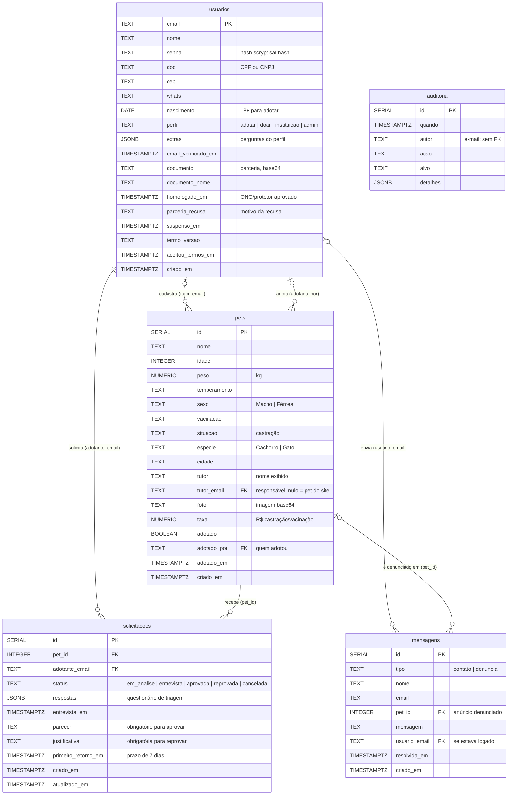

# Banco de dados — PetMatch

PostgreSQL. As tabelas são criadas e atualizadas pelo [`schema.sql`](../schema.sql), que o servidor roda a cada vez que inicia.

Versão em imagem: [banco-de-dados.png](banco-de-dados.png).

## Diagrama entidade-relacionamento

## Tabelas

| Tabela | Guarda | Observações |
|---|---|---|
| `usuarios` | Contas de adotantes, protetores, instituições e admin | Senha só como hash scrypt. Documento da parceria em base64, visível só para o admin |
| `pets` | Animais para adoção | `tutor_email` é o responsável (nulo = pet do site, cuidado pelo admin). `adotado_por`/`adotado_em` registram a adoção aprovada |
| `solicitacoes` | Pedidos de adoção | Um pedido ativo por adotante e pet (índice único parcial). No máximo 3 ativos por adotante, regra conferida no servidor |
| `mensagens` | Canal de contato e denúncia | Aceita envio sem login |
| `auditoria` | Operações sobre dados pessoais | Sem chave estrangeira: o registro fica mesmo se o usuário for excluído |

## O que acontece ao excluir

| Quando é excluído… | Efeito |
|---|---|
| um usuário | Os pets que ele cadastrou e as solicitações que fez são apagados; nos pets que adotou, `adotado_por` fica vazio; nas mensagens, `usuario_email` fica vazio |
| um pet | As solicitações dele são apagadas; nas mensagens, `pet_id` fica vazio |
